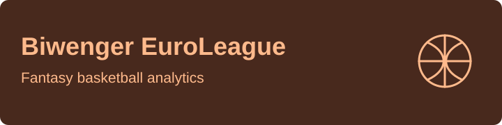
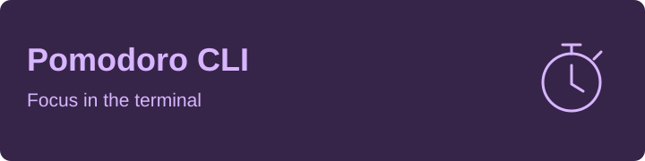

# Carlos Andrés Huete

### Computer Science Student | Software Developer

I build API platforms, web applications, and tools for the terminal.

[Selected projects](#selected-projects) · [Tech stack](#tech-stack) · [Interests](#what-i-like-building) · [Certifications](#certifications) · [Contributions](#contributions)

## Tech Stack

**Languages**

**Web Applications**

**Data & Development Tools**

## What I Like Building

Gateways, authentication, and access control — explored in [API Gateway Platform](https://github.com/c4rl0s04/api-gateway-platform).

Tools that make the terminal more useful and expressive, from [ASCII video playback](https://github.com/c4rl0s04/ascii-motion) to a [Pomodoro timer](https://github.com/c4rl0s04/pomodoro-cli).

Turning basketball data into fantasy-league insights with [Biwenger EuroLeague Stats](https://github.com/c4rl0s04/biwenger-euroleague-stats).

## Selected Projects

<table>
  <tr>
    <td width="50%" valign="top">
      

      
An Apigee-inspired gateway with API key, OAuth, mTLS, and rate-limit policies, plus an OIDC-protected control plane.

      
TypeScript · Next.js · PostgreSQL · Envoy

    </td>
    <td width="50%" valign="top">
      

      
Fantasy basketball analytics with live scoring, market intelligence, and squad-management tools.

      
Next.js · React · PostgreSQL · Drizzle

    </td>
  </tr>
  <tr>
    <td width="50%" valign="top">
      

      
Real-time video playback as ASCII art in the terminal, with seeking, dithering, and multiple rendering modes.

      
Python · OpenCV · NumPy

      
<a href="https://c4rl0s04.github.io/ascii-motion/">Project website</a>

    </td>
    <td width="50%" valign="top">
      

      
A terminal focus timer with a retro 3D clock, work/break cycles, desktop notifications, and session statistics.

      
Go · Cobra · Viper

      
<a href="https://github.com/c4rl0s04/pomodoro-cli#building-from-source">Build & run</a>

    </td>
  </tr>
</table>

Also building **[Spotify Organizer](https://github.com/c4rl0s04/spotify-organizer)** — a Next.js app for browsing playlists and organizing liked songs.

## Currently Exploring

    

> Diving deep into enterprise-grade API management, Privileged Access Management (PAM), and migrating legacy infrastructure to modern API Gateways.

## Certifications

* **[Oracle Database 23ai SQL Associate](https://catalog-education.oracle.com/pls/certview/sharebadge?id=742BD48671235356175C0E6DBE934D2368D25C0853BED7239CE57B9922B3E39F)**
* **[PCEP – Certified Entry-Level Python Programmer](https://www.credly.com/badges/8379acb9-1f63-4041-8d49-7b4e8f3c67fa/public_url)**

## Contributions

A year of GitHub activity, rendered as a 3D landscape.

<picture>
  <source media="(prefers-color-scheme: dark)" srcset="./profile-3d-contrib/profile-night-green.svg?v=2">
  <source media="(prefers-color-scheme: light)" srcset="./profile-3d-contrib/profile-green.svg?v=2">
  
</picture>

Generated daily from GitHub activity. <a href="https://github.com/yoshi389111/github-profile-3d-contrib">Visualization credits</a>.
