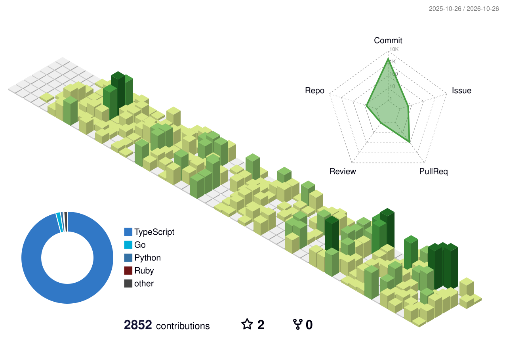

# Carlos Andrés Huete

Computer Science student · Software developer

Exploring API management, identity, and security — from API gateways to privileged access management.

**Tools I work with** 
Python · Java · C++ · JavaScript · Bash 
FastAPI · React · Next.js · PostgreSQL · Docker · Linux

<picture>
  <source media="(prefers-color-scheme: dark)" srcset="./profile-3d-contrib/profile-night-green.svg">
  <source media="(prefers-color-scheme: light)" srcset="./profile-3d-contrib/profile-green.svg">
  
</picture>

Certifications

* **[Oracle Database 23ai SQL Associate](https://catalog-education.oracle.com/pls/certview/sharebadge?id=742BD48671235356175C0E6DBE934D2368D25C0853BED7239CE57B9922B3E39F)**
* **[PCEP – Certified Entry-Level Python Programmer](https://www.credly.com/badges/8379acb9-1f63-4041-8d49-7b4e8f3c67fa/public_url)**

